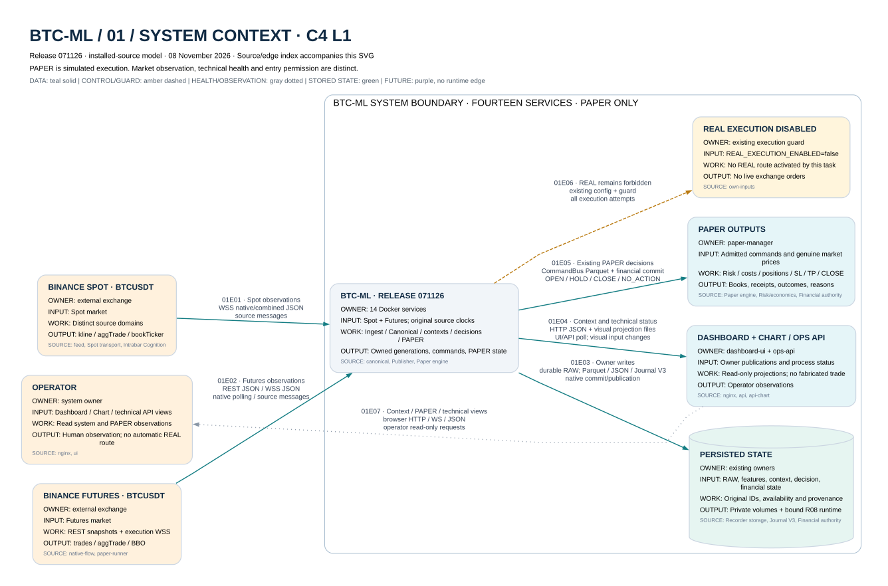

# BTCML_SYSTEM_ARCHITECTURE_071126

Описание установленной системы на release 071126. Оно составлено по actual container configuration, установленным исходникам каждого image и read-only overlays. Код разных компонентов хранится отдельно: наличие более свежего файла в host checkout не делает его установленным. Runtime состоит из 14 контейнеров; R08 принадлежит Paper как child. REAL execution выключен.

Это руководство описывает существующие вычисления и владение данными. Backup/restore проверки не создают рыночную квалификацию. Фактическая готовность live/PAPER и состояние источника должны читаться из owner outputs с timestamp. Все математические коэффициенты/пороги остаются в их закреплённом исходнике и private policy; данная работа их не меняла.

## Путь данных и независимые ветви

Полный набор: [8 подробных схем + обзор14контейнеров](../ARCHITECTURE_DIAGRAM_INDEX.md).

Стрелки обозначают ownership/consumption, не один синхронный callback. Feed, Cognition, native Legacy, Publisher и execution имеют независимые циклы. Spot Recorder не является Futures execution feed. Синхронизация проходит через собственные versions, source references, availability/receive metadata, committed generations и команды. Один более новый файл или heartbeat не подтверждает готовность всей цепи.

## 1. Stage1

Stage1 превращает наблюдённые сообщения/поток в геометрию, объёмные и поведенческие признаки. Экономический вопрос — где приложено усилие и какой ценовой результат оно дало: принятие движения, остановка, отказ или сохранение процесса. Объём не означает сторону сам по себе. Имена старых engine файлов не дают права менять их формулы или единицы.

Фактический orchestrator — `run.py` → `src/btc_ml/runtime/pipeline.py`. Dependency guard проверяет нужные источники/изменения. Engine registry выбирает in-process либо subprocess/persistent-worker путь; guard ограничивает отдельный engine и публикует SUCCESS/FAILED/TIMEOUT/SKIPPED. Atomic parquet helper пишет temp, делает предусмотренный durable/validation этап и только затем replace. Неопубликованный temp не становится готовым feature generation.

После прохода работают существующие metadata hooks и затем loop delay 5 s. Это не обещание полного пересчёта каждые пять секунд: dependency skips, длительность engine и timeout учитываются отдельно. Benchmark/research entrypoints, найденные в source, в задаче сохранения не запускались.

Текущий env `BTC_ML_STAGE2_SYNTHESIS_INPUTS_LIVE` = `1`; порядок содержит **28** шагов. Он вычислен из сохранённых literal lists и actual env, без запуска pipeline. Старые комментарии «21/26» не использованы как счётчик.

1. `candle_structure_engine_v1.py`
2. `volume_localization_engine_v1.py`
3. `candle_geometry_engine_v2.py`
4. `volume_localization_engine_v2.py`
5. `volume_classification_engine_v1.py`
6. `schema_validation_engine_v1.py`
7. `behavioral_sequence_memory_v1.py`
8. `behavioral_volume_observer_v1.py`
9. `microstructure_candle_engine_v1.py`
10. `volume_response_engine_v1.py`
11. `climactic_behavior_engine_v1.py`
12. `auction_convergence_engine_v1.py`
13. `live_volume_flow_engine_v1.py`
14. `liquidity_cluster_engine_v1.py`
15. `flow_liquidity_interaction_engine_v3.py`
16. `htf_structure_engine_v1.py`
17. `htf_ltf_context_engine_v1.py`
18. `auction_synthesis_engine_v1.py`
19. `stage2_cognition_runtime_v1.py`
20. `runtime_cognition_engine_v1.py`
21. `intermediate_cognition_engine_v1.py`
22. `auction_reinforcement_engine_v1.py`
23. `probabilistic_auction_engine_v1.py`
24. `auction_context_arbitration_engine_v1.py`
25. `auction_decay_engine_v1.py`
26. `state_transition_engine_v1.py`
27. `adaptive_meta_cognition_engine_v1.py`
28. `mtf_availability_runtime_engine_v1.py`

## 2. Stage2

Stage2 собирает аукционные и структурные наблюдения в когнитивное состояние с provenance. Важна последовательность: upstream evidence должен быть доступен до соответствующего решения. Synthesis-input producers включаются существующим env gate и вставляются перед auction synthesis. Нельзя восстановить отсутствующий source нулём или позже выдать backfill за ранее известный признак.

Установленный Publisher использует `scripts/live/run_causal_context_chain_candidate.py` и существующие `external_traders` builders. Слово candidate/shadow в имени файла не доказывает, что он не работает: его фактический child был записан в P0. Staging/freeze/snapshot/native preparation/pins — технические стадии одного принятого прохода. Установленный NativeSourcePass reuse сохраняет fingerprint, SHA, admission и расчёты; общий глобальный кэш четырёх больших frames этой работой не создавался.

## 3. Auction model

Аукционный слой различает движение, принятое рынком, и усилие, не получившее продолжения. Геометрия бара показывает результат; объёмные/потоковые признаки добавляют усилие и расположение; behavioral memory сохраняет развитие. Climax или stopping volume рассматриваются в контексте процесса, а не как безусловная команда купить/продать. Согласование evidence выполняют convergence/synthesis/arbitration; текущие пороги и приоритеты закреплены exact sources.

Итоговый контекст является объяснимым модельным наблюдением, не исполненным ордером. Доступность, подтверждение lifecycle, фазовая готовность и риск проверяются позже своими owners. Исторические LONG/SHORT proposals в журнале не объявляются установленными только потому, что присутствуют в документах.

## 4. Cognition

`run_intrabar_cognition_service.py` принимает genuine Spot BTCUSDT aggTrade/bookTicker, нормализует source/session/receive fields и направляет их в bounded archival queue и intrabar cognition. Архивный writer сохраняет Parquet/ZSTD chunks, sidecar SHA и manifests атомарно. В source задана policy 50k events / 60 s для chunk; это техническая публикация, не формула торговли.

Provisional intrabar состояние и закрытый бар различаются. ClosedBarContextEventBridge публикует предусмотренные context events; полнота локальной истории не выводится из одного следующего тика. В metadata сохраняются exchange time, local receive time/order и session identity. Сравнивать независимые часы напрямую нельзя; backup сохраняет исходные значения.

Особенность сохранения: исходный Cognition image `093f628a…` отсутствовал в image store. Он реконструирован из фактического read-only rootfs с сохранёнными user/cwd/entrypoint/CMD/env. Новый restore image `348073d3…` отдельно загружен и проверен: UID 10001, cwd /app, 846 source files совпали, service module импортирован без запуска приложения/сети/production mounts. Это подтверждение artifact, не утверждение byte identity image и не full runtime test.

## 5. Независимые M15/M30/H1/H4

Живые execution TF — M15, M30, H1, H4: 900/1800/3600/14400 секунд. D1 не является пятым trader. Для каждого используются собственные admitted contributors, native closed bars, Final/Lifecycle/phase и состояние. M15 хранится в основном cognition root, старшие — в `cognition/timeframes/TF`. Фактический путь каждого файла дан в inventory/registry.

Publisher публикует собственные поколения. Времена разных owners/TF могут различаться; backup явно сохраняет их generations, а не делает одинаковыми. Consumer проверяет source bar close/availability и собственный TF. Отсутствие H4 в коротком live-наблюдении не заменяется M15 и не означает автоматически вычислительный дефект.

Spot bar-close R08 — kline именно соответствующего TF с `k.x=true`; D1 не подписан. Его объём не добавляется повторно к aggTrade q. Закрытие биржевого бара и полнота локально наблюдённых сделок — разные входы seal. Первый частично наблюдённый бар остаётся waiting for coverage. Поздний kline не считается известным раньше получения; уже записанная первая сделка следующего бара не теряется, duplicate close не создаёт второй переход. Сохранённая реализация решает порядок ограниченной очередью/одним worker, не блокируя WebSocket receive на ожидании закрытия.

## 6. Trend Strength, W1/R1 и Context Phase

`context_trend_integration.py` прямо потребляет существующий `Final/Lifecycle.process_strength`. Интеграция не вводит новую числовую формулу. Сила и направление — разные свойства: сильное движение может быть SHORT; отсутствие числового значения не заменяется произвольной средней/нулём. Точные W1/R1 условия и их ранее принятые исправления сохранены как исходники и provenance, без новой квалификации.

Context Phase публикуется существующим native Publisher после Lifecycle через `external_traders/context_phase_publication.py` и `trend/context_phase_qualification.py`. Sidecar имеет собственные ancestors, source witness, own-TF snapshot и cutoff/availability. Архивная классификация не получает LIVE статус от свежей receipt. Новая native generation и действительный source scope проверяются существующим qualifier. Числовой process_strength не пересчитывается sidecar.

Отдельно существует R08/DRA R2 trend state machine: FORMING, CONFIRMED/ACTIVE, WEAKENING, EXHAUSTED, REACTIVATING и предусмотренный BREAK/recovery путь. Это не повод переименовать Context Phase или подменить её numeric strength. Opportunity становится пригодной только при соответствующем существующем переходе и источнике.

## 7. R08, baseline, инициатива и Journal V3

Штатный путь: Spot combined receive → ограниченная очередь → единственный worker → Recorder durable commit/ACK → прямой RecorderLiveAdapter → baseline provider / ResearchSystem → committed Journal/status. Callback не ждёт тяжёлый ingest/commit. Receive metadata фиксируется при получении, ACK — после сохранения; enqueue не является ACK. Оригинальный monotonic ACK задаёт локальный порядок, exchange timestamps остаются исходными.

Baseline выбирается по утверждённому окну `[T_cursor−300s, T_cursor)` из предусмотренных Spot BTCUSDT contributors, наблюдённых до выбранного cursor. Нужен настоящий предшествующий observed prefix, без неизвестного gap, инициативы и будущих/поздно восстановленных сообщений. Суммируется literal unsigned q в BTC. Consumer использует `Q / (last contributor T − first contributor T)` с переводом span в секунды. `Q/300`, aggTrade count, USDT turnover и signed delta не подставляются вместо него. Нулевой span/неполное наблюдение дают конкретную неготовность, epsilon не используется.

В `Observation.measurements` объём инициативы равен sum(q), delta — сумме signed_quantity, duration — span её contributors, participation = initiative_Q / (baseline_rate × initiative_span). Baseline и конфигурация фиксируются один раз до допустимого начала инициативы. Параметры метода известны заранее; конкретный prefix естественно накапливается после подключения WS.

После INIT события, уже полученные до фактической готовности baseline/Context/policy/INIT, сохраняются и учитываются по порядку, но не становятся инициативой с более поздней базой. Они не добавляются задним числом в frozen baseline. Первый кандидат — первый действительно eligible receive после readiness fence; dequeue time не заменяет original receive. Реальный predecessor и first-eligible ordering сохранены. FUTURE_BASELINE/RAW_AVAILABILITY остаются проверками с правильными clock domains и смыслом cutoff.

A/B/R и DRA/R2 обрабатывают все необходимые события и независимые TF состояния; baseline shared immutable, изменяемые части не делятся между TF. Retained-reader остаётся строгим reader законченного inventory. Live callback не требует заранее знать manifest_count/tip будущего архива. Existing delivery/session/pins и duplicate protection сохраняются.

Journal format — `DRA_RESEARCH_JOURNAL_V3_DELTA`. Он сохраняет компактные delta/reference records и восстанавливает committed state последовательно; V1 snapshots и V2 deltas читаются. В V3 служебная record identity не называется полным SHA logical state; `state_sha` для V3 запрещён. Полный growing-state digest не возвращён в per-event hot path. Неуспешная запись не должна продвинуть committed state; source/contributors и предыдущие принятые оптимизации сохранены.

S0 и независимый S1 остаются отдельными наблюдениями/допусками. Отсутствие инициативы в технически текущем участке даёт NO_ELIGIBLE_INITIATIVE, а не дефект A/B/R. Missing bindings/source failure остаются технической блокировкой. В этой работе новые S0/S1, permission или LIVE_QUALIFIED не создавались.

## 8. Shadow modules

В images сохранены shadow auction, structural protection, economic correlation, shadow laboratory и их source/outcome/memory modules. Их назначение — сохранить альтернативные наблюдения, отказы, структуры риска/защиты и outcomes с собственным scope. Наличие package не означает отдельную активную службу: в actual Compose 14 roles, отдельного нового shadow контейнера нет. Некоторые builders вызываются Publisher внутри существующей цепи; точные calls/outputs перечислены в module reference.

Shadow или исследовательская оценка не заменяют live source permission. Токсичность, экономические diagnostics, MFE/MAE/labels сохраняются как имеющиеся outputs, не вычисляются заново для заявления качества. Отсутствующий outcome отмечается missing, не дорисовывается.

## 9. LONG/SHORT setups и управление контекстом

Направление приходит из собственного Final/Lifecycle процесса и принятого evidence, затем проходит текущие strength/phase/R08/DRA и risk условия. Setup не создаётся из графической окраски или одного объёмного сообщения. Закрытая и формирующаяся свеча имеют разные роли. Принятые execution исправления сохраняют приоритет подходящего закрытого собственного контекста, корректную противоположную сторону и отсутствие закрытия позиции чужой старой protective-командой.

Исторический журнал содержит принятые execution исправления и отдельные когнитивные предложения. Их статусы разделены в changelog; описание старого предложения не переписывает installed алгоритм. Cross-timeframe metadata не превращается в произвольный глобальный запрет независимому TF. Ни один synthetic initiative/OPEN в backup проверках не создавался.

## 10. Decision / Risk / Execution

TimeframeManager получает own-TF point-in-time state, availability, lifecycle episode, numeric strength/phase и действительные bindings. Команда содержит evaluation/source bar timestamps, intent, reason_codes, risk и lineage. Детерминированный command_id предотвращает повторный эффект того же решения; Paper хранит consumption cursor и processed identity. ACK/commit подтверждают разные стадии, их нельзя смешивать с скачанными/queued событиями.

В существующем cost-aware sizing риск на BTC включает stop distance и ожидаемые entry/stop fees/slippage. Из installed `economics.resolve_risk_sizing`: per_btc = distance + entry×entry_fee_rate + stop×exit_fee_rate + entry×entry_slippage_rate + stop×stop_exit_slippage_rate; qty = risk_amount/per_btc. Непригодная цена/stop distance отклоняется. Risk amount задаётся текущей sleeve/capital policy, а не новым параметром этого отчёта. Дальнейшие limits/rounding/position constraints остаются в закреплённом execution коде.

Paper — единственный ledger writer. Futures aggTrade и BBO проходят WAL/continuity/currentness; OPEN запрещён при текущей технической неготовности. SL/TP и protective management остаются непрерывными в штатной работе. Real exchange execution отключён. Owner approval PAPER не означает искусственную команду входа или отмену остальных guards.

## 11. Paper accounting

Closed-trade экономика использует сторону, фактические paper fill prices/quantity, комиссии и slippage. Для LONG и SHORT знак ценового результата различается; costs не переименовываются в доход. Realized equity, risk sleeves, позиции, fills, trades, fees, financial generations и currentness публикуются владельцем. Dashboard/API читают эти результаты, не создают параллельный PnL calculator.

Financial provenance исторического состояния отделена от implementation pins выбранного принятого release. Старые snapshot/approval/binding/anchor и receipts сохраняются с оригинальными SHA. Это не утверждение, будто прежнее approval подтверждало новые bytes. Drift check остаётся точным; arbitrary current SHA «чтобы прошло» не подставляются.

## 12. Persistence и recovery

RAW, manifests, delivery receipts, ACK, R08 journals, Paper WAL/checkpoints, CommandBus/cursors, native books, financial heads и Context generations — разные сохраняемые owners. Durable commit-before-ACK и fsync остаются неизменными. Unacknowledged/pending tails архивируются как есть и не объявляются завершёнными.

Coherent backup остановил writers и сохранил независимые committed generations; временная staging работа явно отделяется. Внешние bind snapshots используют APFS copy-on-write, не меняя originals. Volume архивы содержат SHA каждого payload/link и обычный tar representation. Одинаковые независимые файлы могут храниться content links: restore helper сначала materializes независимые bytes, затем восстанавливает только настоящие исходные hardlinks. Это backup encoding, не новый Journal/финансовый протокол.

Restore не сбрасывает WAL, позиции или cursors. Исторический replay/backfill до T0 не выполняется. Source timestamps/receipts не корректируются, и captured prefix не выдаётся за новый live S0. Полный runtime restore и artifact verification имеют отдельные статусы.

## 13. Operational monitoring

Runtime owners публикуют собственные health/leases/projections. OPS API добавляет bounded read-only Docker GET observation: actual ID/image/state/PID/children и сопоставимые CPU counters. Старый heartbeat не становится fresh от нового запроса UI. RUNNING, healthcheck, processing progress, source availability и PAPER entry state представлены отдельно. Неизвестное поле остаётся UNKNOWN/UNAVAILABLE.

Release 071126 объединяет Dashboard и Chart одним nginx, показывает один release manifest в header/About/API и 14 actual services. Chart использует собственные native Final/Lifecycle/phase и UTC bar bounds каждого TF; M15 fallback на старшие не создаётся. Owner-provided financial outputs сохраняют свою ответственность.

Инцидент ENOSPC при backup не объяснялся размером init.log: временный maintenance reader ошибочно логировал binary stdout. Он исправлен на log-driver none, normal app logging не отключалось. Подробности, измерения space и неизменность frozen heads — в `INVENTORY/ENOSPC_CAUSE_AND_FIX.md`. Это не новая R08 performance квалификация.

## 14. Training / calibration / corpus

Сохраняются существующие tick/bar inputs, features, canonical masters, labels/outcomes, split/calibration manifests, model binaries и system evidence. Registry разделяет RAW market events, contexts, decisions, trade outcomes, rejections, shadow и research-only/fixture данные. Ни backtest, ни archive comparison, ни technical fixture не получают genuine/live статус от переупаковки.

Для каждого набора фиксируются источник/schema/units/instrument/TF, доступный период и counts, IDs, gaps, связи с RAW/outcomes, causal availability, SHA и provenance. Если producer не записал local receive/order, архив доказывает только биржевое время. Если label/outcome или исторический source отсутствует, он остаётся MISSING/NOT_RECORDED. Неизвестный поток не заполняется нулями; будущие признаки не восстанавливаются задним числом.

Master Book находится в canonical reconstruction corpus; ранее проверены 17,409 candidate rows. Registry/manifest фиксируют фактический файл и checksum; историческая training/admission qualification не расширяется этой работой. Existing model binaries индексируются без unpickle/fit. Новая синтетика не создаётся. Большие неизменные originals на MaksTiger остаются на своих путях и получают логические ссылки/retention mapping, без второй физической копии всего корпуса.

## Расхождения с прежними документами

| Источник | Фактическое уточнение |
|---|---|
| Старый CANONICAL_RUNTIME_MAP: master auction/17 шагов | Installed run.py и actual configured pipeline list выше. |
| Старый target document с тремя top-level services | Actual frozen release состоит из 14; Chart integrated в UI, R08 — child Paper. |
| Комментарии pipeline «21/26» | Счётчик берётся из actual literals/env, не комментария. |
| Docstring provider DRAFT | Историческая annotation сохранена; owner-approved 300s/Q/T-span recipe и release provenance отдельно, без изменения кода. |
| Старый root checkout | Может не содержать financial_candidate entrypoint и текущий V3; installed component archives/images приоритетны. |
| Docker RUNNING или старое alive=true | Не доказывает fresh processing; сравнивать actual process state, timestamp и committed cursor. |
| Отсутствующий original Cognition image | Новый restore artifact явно реконструирован, identity не приравнивается к старому image. |

## Module reference и границы вывода

Ниже и в `MODULE_REFERENCE` даны owner, фактический source, входные/выходные IO expressions, методы и failure semantics. Symbolic пути разрешает сохранённый path_registry; исходные bytes и private конфигурация доступны из backup без старого checkout. Наличие research package отмечается отдельно от live callgraph. Неподтверждённые универсальные latency/peak нормы не придуманы.

## Точная граница OHLCV-derived volume и genuine Spot q

В установленном candle_structure_engine_v1.py вход — уже существующая история канонического live feed (`read_live_feed_history`), а не создание нового genuine tick capture. Строки сортируются и дедуплицируются по timestamp. Если taker_buy_volume есть, buy_volume берётся из него, sell_volume=max(volume−buy_volume,0). Иначе код использует существующую OHLC-прокси: body_share=clip(abs(close−open)/(high−low+0.000001),0,1), buy_volume=volume*(0.5±0.5*body_share) по направлению тела, sell_volume=volume−buy_volume; delta=buy_volume−sell_volume. Это описание принятого кода, без его изменения или новой квалификации.

Такой candle-derived split нельзя выдавать за literal unsigned Spot q или за настоящую последовательность aggressor executions. R08 baseline читает собственные genuine Spot contributors и остаётся sum(q)/(last contributor T−first contributor T), BTC/с; его нулевой T-span не исправляется epsilon. Существующий epsilon в другом Stage1 candle-derived признаке не переносится в baseline. Market/source identity определяется конкретным source record/config, а не одним символом BTCUSDT.

Filesystem copy/restore/COW timestamps, даже сохранённый mtime, не доказывают историческую доступность признака. Её подтверждают исходные receive/ACK/owner publications и предусмотренные clock domains; exchange time архива сам по себе не является локальным ACK.
<!-- CLEANUP_REVISION_20261108 -->

## Уточнение фактических маршрутов — 08.11.2026

[C4 L2](../ARCHITECTURE_DIAGRAMS/02A_FOURTEEN_CONTAINERS_OVERVIEW.svg), [Stage1 DFD](../ARCHITECTURE_DIAGRAMS/03_STAGE1_SOURCE_AND_DERIVATION_DFD.svg), [Stage2 DFD](../ARCHITECTURE_DIAGRAMS/04_STAGE2_CONTEXT_R08_ADMISSION.svg), [четыре TF](../ARCHITECTURE_DIAGRAMS/05_FOUR_INDEPENDENT_TIMEFRAME_CONTEXTS.svg), [execution](../ARCHITECTURE_DIAGRAMS/06_TRADING_DECISION_COMMAND_PAPER_EXECUTION.svg).

Watchdog принимает Spot kline15m. Native Legacy collector использует Futures REST trades; Clusters/Inventory, Memory/Regime и Reactions/Acceptance — параллельные пары, а не одна последовательная цепь. Memory читает flow и clusters; его история не объявляется прямым входом Canonical. Regime и предусмотренные native publications поступают через существующие source adapters. Candle-derived Spot flow/liquidity не является переименованным native Futures flow.

Publisher читает семь frozen INPUTS и native snapshots, выполняет собственные Auction/Cognitive/Final, Lifecycle с admitted Stage2 evidence, Context Phase и owner publication. M15 private September boundary и независимые higher-TF callbacks показаны отдельно. Он не запускает все Stage2 engines вторым полным Canonical pass. Параллельный Cognition получает собственный Spot aggTrade/BBO; ClosedBarContextEventBridge читает новые admitted closed contexts. Его provisional CTX journal не подставляется в действующий S4.1 entry input: state_adapter выбирает closed-bar Parquet.

CommandBus — `timeframe_command_memory.parquet`, не JSONL. S41CommandConsumer хранит собственный cursor и применяет команду через Paper. Intrabar Supervisor наблюдает Compose-owned службы; риск, fill, SL/TP и books принадлежат Paper. Из source routes не следует свежесть текущего потока или разрешение OPEN.

Все стрелки имеют source keys и SHA/line anchors в [едином индексе](../ARCHITECTURE_DIAGRAMS/ARCHITECTURE_SOURCE_INDEX.md). Полный digest V3/торговые формулы/лимиты этой ревизией не изменялись.
